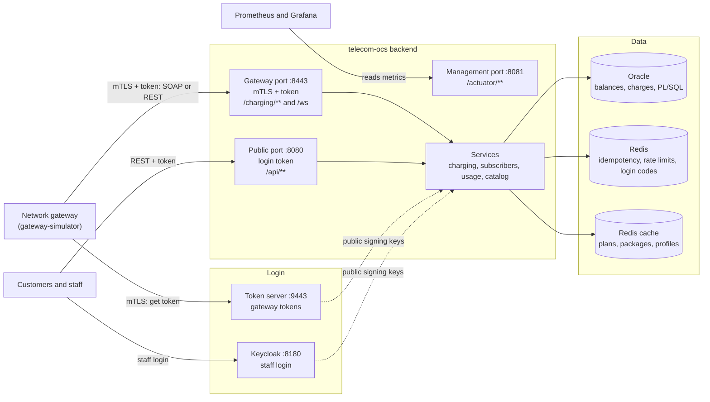

# Telecom Online Charging System (telecom-ocs)

A mobile operator's **online charging system (OCS)**. The network gateway asks before it lets data
through, gets a quota grant (MB, speed, validity) from the right bucket (YouTube Unlimited, WhatsApp,
Extra 25GB, plan data or pay as you go), reports what was used, and is told to block the user when
nothing is left. The system also manages subscribers, plans and data packages.

The gateway API is available over both **SOAP** and **REST**, and is protected with **mTLS, OAuth2
tokens, idempotent retries and rate limiting**. Charging rules run in **Oracle PL/SQL**, so two requests
for the same subscriber can't spend the same balance twice.

**Stack:** Java 21 · Spring Boot 3.4 · Spring Web Services · Spring Security · Spring Authorization Server ·
Oracle Database Free 23ai · PL/SQL · Flyway · Redis · Keycloak · Resilience4j · Prometheus · Grafana ·
Jaeger · Docker Compose · Kubernetes

## Architecture



Oracle is the source of truth for money and quota. If Redis is down, charging keeps working, and Oracle
still stops a retried request from being charged twice.

## Setup

**You need:** Java 21, Maven, Docker with Compose, OpenSSL, and a Bash shell (Git Bash on Windows).

```bash
# 1. Create the test certificates (once). They are not stored in git.
scripts/generate-dev-certs.sh

# 2. Start Oracle, Redis, Keycloak, Prometheus, Grafana and Jaeger.
#    Oracle takes about a minute to be ready on its first start.
docker compose up -d

# 3. Start the token server (port 9443).
mvn -f token-server/pom.xml spring-boot:run

# 4. In a new terminal, start the backend (ports 8443, 8080 and 8081).
mvn spring-boot:run

# 5. Optional: in a new terminal, run the gateway simulator for a full charging session.
mvn -f gateway-simulator/pom.xml spring-boot:run
```

| Service | Address |
|---|---|
| Gateway API (REST and SOAP) | `https://localhost:8443` |
| WSDL | `https://localhost:8443/ws/subscribers.wsdl` |
| Public API | `http://localhost:8080` |
| Token server | `https://localhost:9443` |
| Health and metrics | `http://localhost:8081/actuator/health` |
| Keycloak | `http://localhost:8180` |
| Grafana | `http://localhost:3001` |
| Prometheus | `http://localhost:9090` |
| Jaeger | `http://localhost:16686` |

Sample SOAP requests are in `requests/`. All passwords and certificates in this repo are local test
values only.

## API list

### Gateway REST API (port 8443)

Needs a gateway certificate and an access token.

| Method | Path | Purpose |
|---|---|---|
| POST | `/charging/v1/sessions` | Start a session and get the first grant |
| POST | `/charging/v1/sessions/{sessionId}/update` | Report usage and get the next grant |
| POST | `/charging/v1/sessions/{sessionId}/release` | Report final usage and end the session |
| GET | `/charging/v1/commands` | Poll for BLOCK and UNBLOCK commands |
| POST | `/charging/v1/commands/{id}/ack` | Confirm a command was applied |

Start, update and release need an `Idempotency-Key` header.

### Gateway SOAP API (port 8443)

All operations are `POST /ws`, with the same certificate and token rules. `StartSession`,
`UpdateSession` and `ReleaseSession` also need an `Idempotency-Key` header.

| Operation | Purpose |
|---|---|
| `ListPlans` | List all plans |
| `CreateSubscriber` | Create a subscriber on a plan |
| `GetSubscriber` | Get a subscriber with plan details |
| `GetBalance` | Get the current balance |
| `TopUp` | Add credit |
| `ChangePlan` | Move to another plan |
| `ListPackages` | List all data packages |
| `ActivatePackage` | Buy a package from the balance |
| `RecordUsage` | Charge MB used by an app and return the speed limit |
| `GetQuota` | Get the data left in every bucket |
| `StartSession` | Start a charging session |
| `UpdateSession` | Report usage and get the next grant |
| `ReleaseSession` | Report final usage and end the session |

### Public REST API (port 8080)

"Customer" means the customer's own number only. Top-ups and package purchases need an
`Idempotency-Key` header.

| Method | Path | Who | Purpose |
|---|---|---|---|
| POST | `/api/auth/otp` | Anyone | Send a login code by SMS |
| POST | `/api/auth/otp/verify` | Anyone | Exchange the code for a token |
| GET | `/api/plans` | Anyone | List plans |
| GET | `/api/packages` | Anyone | List packages on sale |
| POST | `/api/subscribers` | Staff | Register a subscriber |
| GET | `/api/subscribers/{msisdn}` | Staff, customer | Get a subscriber |
| POST | `/api/subscribers/{msisdn}/top-ups` | Staff, customer | Add credit |
| PUT | `/api/subscribers/{msisdn}/plan` | Staff, customer | Change plan |
| POST | `/api/subscribers/{msisdn}/packages` | Staff, customer | Buy a package |
| GET | `/api/subscribers/{msisdn}/quota` | Staff, customer | Get the data left |
| GET | `/api/subscribers/{msisdn}/usage` | Staff, customer | Get usage history |
| PUT | `/api/subscribers/{msisdn}/suspension` | Staff | Suspend a subscriber |
| DELETE | `/api/subscribers/{msisdn}/suspension` | Staff | Remove a suspension |
| GET | `/api/subscribers/{msisdn}/audit` | Staff | Get the audit trail |
| POST | `/api/subscribers/{msisdn}/usage` | ADMIN | Record usage (test tool) |
| GET | `/api/admin/packages` | ADMIN | List every package |
| POST | `/api/admin/packages` | ADMIN | Create a package |
| PUT | `/api/admin/packages/{code}/price` | ADMIN | Change a price |
| PUT | `/api/admin/packages/{code}/speed` | ADMIN | Change a package's speed |
| PUT | `/api/admin/packages/{code}/status` | ADMIN | Start or stop selling a package |
| GET | `/api/admin/packages/{code}/prices` | ADMIN | Get price history |
| PUT | `/api/admin/plans/{code}/speed` | ADMIN | Change a plan's speed |

### Token server (port 9443)

| Method | Path | Purpose |
|---|---|---|
| POST | `/oauth2/token` | Get a gateway access token (needs a gateway certificate) |
| GET | `/oauth2/jwks` | Get the public signing keys |
